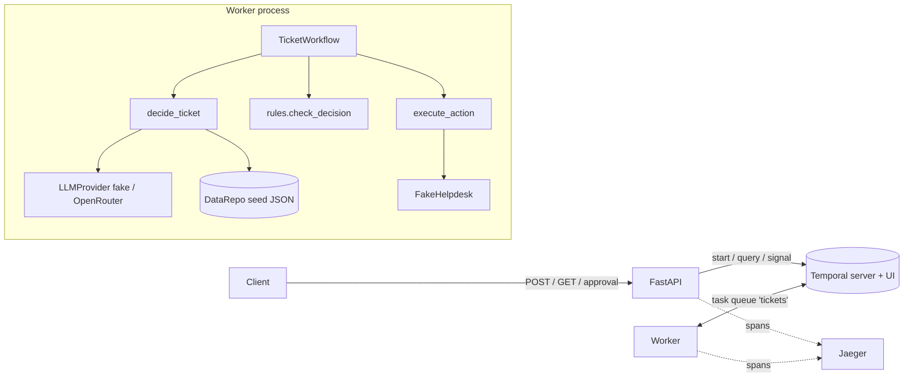

# ticketflow

Backend that triages support tickets with an LLM agent, on a durable Temporal workflow. FastAPI in front.

## What it does

One ticket → one workflow:

1. **Decide**: LLM agent calls tools (`get_customer`, `get_invoices`, `search_kb`), then `submit_decision` → category, priority, one action.
2. **Check**: pure-code business rules. Rule broken → escalate.
3. **Approve** (refunds only): human approves/rejects via API. No answer in 24h → escalate.
4. **Act**: `reply` / `refund` / `escalate` / `close` through a fake Helpdesk, idempotent.

LLM: `LLM_MODE=fake` (default, rule-based, no key/network) or `openrouter`.

## Flow




Step by step:

1. `POST /tickets` starts `TicketWorkflow` (id `ticket-<ticket_id>`), returns at once.
2. Worker runs `decide_ticket`: agent loop (model calls tools → code runs them on `DataRepo` → results back) until `submit_decision`.
3. Workflow runs `check_decision` on the decision + invoice snapshot.
4. Valid refund → wait for `approval` signal.
5. `execute_action` calls Helpdesk with key `<workflow_id>:<action_type>`.
6. `GET /tickets/{id}` reads the workflow `status` query.

## Tech stack

Python 3.12+ · FastAPI · Temporal (`temporalio`) · OpenAI-compatible client (OpenRouter) · OpenTelemetry + Jaeger · pytest · Docker Compose · GitHub Actions.

## Layout

| Package | Role |
|---|---|
| `ticketflow/api` | HTTP layer, `TicketService` (start / query / signal) |
| `ticketflow/workflow` | `TicketWorkflow`, retry policies |
| `ticketflow/activities` | `decide_ticket` (agent loop, prompt, tools), `execute_action` |
| `ticketflow/rules` | `check_decision`, pure, imports only `models` |
| `ticketflow/services` | `llm/` (fake, OpenRouter), fake Helpdesk |
| `ticketflow/data` | `DataRepo` + seed JSON |
| `ticketflow/observability` | JSON logs, OpenTelemetry |

## Run

```bash
cp .env.example .env          # fake mode, no key needed
docker compose up --build
```

| Service | URL |
|---|---|
| API | http://localhost:8000 (docs `/docs`) |
| Temporal UI | http://localhost:8233 |
| Jaeger (traces) | http://localhost:16686 |

Without Docker: `pip install -e .[dev]`, `temporal server start-dev`, then `python -m ticketflow.worker` and `uvicorn ticketflow.api.main:app`.

### Config (`.env`)

| Var | Meaning |
|---|---|
| `LLM_MODE` | `fake` or `openrouter` |
| `OPEN_ROUTER_API_KEY`, `OPENROUTER_MODEL` | needed for `openrouter` (worker fails at start without key) |
| `LLM_MAX_TURNS`, `LLM_MAX_INVALID_ANSWERS` | agent loop bounds |
| `HELPDESK_FAILURE_RATE` | chance a Helpdesk call fails transiently (0.2 in example) |
| `APPROVAL_TIMEOUT_SECONDS` | approval wait, default 86400; use `60` for demos |
| `OTEL_EXPORTER_OTLP_ENDPOINT` | set → spans exported; unset → tracing off |

## API

```bash
# Start ticket: 202 {"ticket_id":"T-2","workflow_id":"ticket-T-2","created":true}
# Same id again: 200 {"created":false}, not reprocessed
curl -s -X POST localhost:8000/tickets -H 'content-type: application/json' -d '{
  "ticket_id": "T-2", "customer_id": "C-100", "subject": "Charged twice",
  "body": "We were charged twice for September. Please refund the extra payment."}'

# Status: step, proposed/final decision, violations, approval, result
curl -s localhost:8000/tickets/T-2

# Approve or reject waiting refund: 202; 409 not awaiting approval; 404 unknown
curl -s -X POST localhost:8000/tickets/T-2/approval -H 'content-type: application/json' \
  -d '{"approved": true, "reviewer": "ana"}'
curl -s -X POST localhost:8000/tickets/T-2/approval -H 'content-type: application/json' \
  -d '{"approved": false, "reviewer": "ana", "comment": "not a duplicate charge"}'
```

Seed tickets: `ticketflow/data/seed/tickets.json`. Fake-mode outcomes:

| Ticket | Final action |
|---|---|
| T-1 | reply citing KB-1 (account, normal) |
| T-2 | refund INV-1002 49.00 after approval (billing, normal) |
| T-3 | escalate: urgent technical issue |
| T-4 | reply citing KB-4, names overdue INV-4001 (account, high) |
| T-5 | close: off-topic (other, low) |
| T-6 | escalate: injection asks 5000 EUR refund, rule blocks it |
| T-7 | escalate: unknown customer C-999, no LLM call |

## Tracing and logs

With `OTEL_EXPORTER_OTLP_ENDPOINT` set (compose points it at Jaeger), one ticket = one trace: `POST /tickets` → `StartWorkflow` → `RunWorkflow` → `RunActivity` (`decide_ticket`, `execute_action`). Open Jaeger, service `api`.

Logs are JSON lines on stdout; ticket lines carry `ticket_id`, `workflow_id`, and `trace_id`/`span_id` when a span is active.

## Tests

```bash
pip install -e .[dev]
pytest -q
```

- No API key, no network. Exception: first run downloads Temporal's test-server binary; for offline set `TEMPORAL_TEST_SERVER_PATH`.
- Workflow tests use `WorkflowEnvironment.start_time_skipping()` + fake activities (24h timeout runs instantly).
- Also: rule unit tests, activity tests (scripted LLMs), API tests (in-memory + end-to-end on Temporal test server), tracing tests, static repo checks.
- CI: `.github/workflows/tests.yml` runs `pytest -q` on every push.
