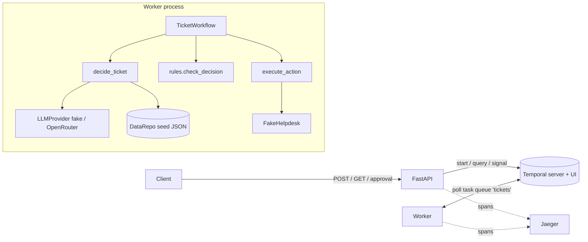

# Design: Agentic support-ticket workflow (FastAPI + Temporal)

Minimal design. Decision ids D1..D24 are in `intent.md`. Seed-data specifics are only in Appendix A.

## Module layout
```
pyproject.toml            # python>=3.12; deps: temporalio[opentelemetry], fastapi, uvicorn[standard], pydantic>=2,
                          #   openai, httpx, opentelemetry-sdk, opentelemetry-exporter-otlp-proto-http,
                          #   opentelemetry-instrumentation-fastapi ; dev: pytest, pytest-asyncio, pyyaml
pytest.ini                # asyncio_mode = auto, testpaths = tests
conftest.py               # unsets OPEN_ROUTER_API_KEY/LLM_MODE/OTEL_EXPORTER_OTLP_ENDPOINT; workflow-env fixture
Dockerfile                # one image; command chosen in compose (api | worker)
docker-compose.yml        # temporal (start-dev, :7233, UI :8233), api (:8000), worker, jaeger (UI :16686, OTLP :4318)
.env.example
.github/workflows/tests.yml
README.md
ticketflow/
  config.py               # Settings, load_settings(env), ConfigError
  models.py               # pydantic models + ALLOWED_* constants (no framework imports besides pydantic)
  data/
    repository.py         # DataRepo: the only data-access module (tools and rule inputs come from here)
    seed/                 # customers.json invoices.json kb.json tickets.json  (seed/demo data from the brief)
  rules/
    decision_rules.py     # check_decision (pure)
  services/
    llm/base.py           # LLMProvider protocol, LLMReply, ToolCall
    llm/fake.py           # FakeLLM (keyword rules)
    llm/openrouter.py     # OpenRouterLLM (openai SDK, OpenRouter base URL)
    llm/factory.py        # build_llm(settings)
    helpdesk.py           # Helpdesk protocol, FakeHelpdesk, HelpdeskTemporaryError
  activities/
    agent.py              # SYSTEM_PROMPT, TOOLS, build_messages, run_agent (bounded loop)
    ticket_activities.py  # TicketActivities: decide_ticket, execute_action
  workflow/
    ticket_workflow.py    # TicketWorkflow, DECIDE_RETRY, ACT_RETRY, step names
  observability/
    logging.py            # JsonFormatter, setup_logging
    tracing.py            # setup_tracing, tracing_interceptor
  temporal_client.py      # connect(settings) -> Client (data converter + TracingInterceptor + bounded connect retry)
  worker.py               # python -m ticketflow.worker
  api/
    service.py            # TicketService protocol, TemporalTicketService
    main.py               # create_app(...); app = create_app()  (uvicorn ticketflow.api.main:app)
tests/
  fixtures.py             # small in-memory DataRepo + ticket() helper (see scenarios.md conventions)
  unit/ activities/ workflow/ api/ tracing/ static/
```

## Data flow
```
client --POST /tickets--> API --start_workflow(id=ticket-<id>, REJECT_DUPLICATE)--> Temporal server
                                                                                     |
worker (task queue "tickets") <------------------------------------------------------+
  TicketWorkflow
   1 decide_ticket --> DataRepo (customer exists?) --> agent loop <-> LLMProvider (fake | openrouter)
                        tools get_customer / get_invoices / search_kb -> DataRepo (read-only, bound to customer)
                        returns DecideOutput{proposed, invoices snapshot, known KB ids}
   2 check_decision (pure, in workflow) -> final Decision + violations
   3 refund only: wait_condition(approval, timeout=24h)   <-- signal "approval" <-- API POST /approval
   4 execute_action --> Helpdesk (FakeHelpdesk, idempotency key) --> ActionResult
client --GET /tickets/<id>--> API --query "status" + describe--> Temporal
API + worker --OTLP/HTTP spans--> Jaeger ; JSON logs --> stdout
```
README diagram (mermaid):


## Public interfaces
(what tests call; names are binding, internals are not)

### Models (`ticketflow/models.py`, pydantic v2)
```python
ALLOWED_CATEGORIES = ("account","billing","technical","other"); ALLOWED_PRIORITIES = ("low","normal","high","urgent")
ALLOWED_ACTIONS = ("reply","refund","escalate","close")
class Ticket:             ticket_id: str (^[A-Za-z0-9_-]{1,64}$); customer_id: str (min 1); subject: str (min 1); body: str (min 1)
class Customer:           customer_id; name; plan; status
class Invoice:            invoice_id; customer_id; month: str; amount_eur: float; status: str
class KbArticle:          article_id; title; text
class Action:             type: str; message: str|None=None; article_ids: list[str]=[]; invoice_id: str|None=None
                          amount_eur: float|None=None; reason: str|None=None
class Decision:           category: str; priority: str; action: Action        # shape only (D9)
class CheckResult:        decision: Decision; violations: list[str]
class DecideInput:        ticket: Ticket; workflow_id: str
class DecideOutput:       proposed: Decision; invoices: list[Invoice]; known_article_ids: list[str]
class ExecuteActionInput: ticket_id; workflow_id; idempotency_key; decision: Decision
class ActionResult:       action_type: str; helpdesk_ref: str; duplicate: bool = False
class Approval:           approved: bool; reviewer: str|None=None; comment: str|None=None
class TicketResult:       outcome: Literal["replied","refunded","refund_declined","escalated","closed"]; action: ActionResult
class WorkflowInput:      ticket: Ticket; approval_timeout_seconds: int = 86400
class TicketStatus:       ticket_id; workflow_id; step: str; proposed_decision: Decision|None; decision: Decision|None
                          violations: list[str]; approval: Approval|None; result: TicketResult|None; error: str|None
```
Steps: `received, deciding, checking, awaiting_approval, acting, completed, failed`.

### Rules
```python
def check_decision(proposed: Decision, *, customer_id: str, invoices: Sequence[Invoice],
                   known_article_ids: Collection[str]) -> CheckResult
```
Pure; on violations returns an `escalate` decision per spec R9. Inputs come from `DataRepo` via `DecideOutput`.

### Data access
```python
class DataRepo:
    def __init__(self, customers: list[Customer], invoices: list[Invoice], articles: list[KbArticle],
                 tickets: list[Ticket] | None = None)
    @classmethod
    def from_seed(cls, seed_dir: Path | None = None) -> "DataRepo"   # default ticketflow/data/seed; error names bad file
    def get_customer(self, customer_id: str) -> Customer | None
    def get_invoices(self, customer_id: str) -> list[Invoice]
    def search_kb(self, query: str, limit: int = 3) -> list[KbArticle]
    def known_article_ids(self) -> list[str]
    def tickets(self) -> list[Ticket]
```
`search_kb` (D21): tokens = `re.findall(r"[a-z0-9]+", text.lower())`, drop tokens shorter than 3 and a
small stopword set (`the, and, for, you, your, our, are, can, with, this, that, was, were, has, have, not,
why, what, how, use`); score = |query tokens ∩ article title+text tokens|; return articles with score > 0
sorted by (-score, article_id), at most `limit`. Loaded once at worker start; next step: replace with a DB.

### LLM (provider-neutral format = OpenAI chat format, D15)
```python
@dataclass class ToolCall:  id: str; name: str; arguments: dict | None; raw_arguments: str   # arguments None if JSON invalid
@dataclass class LLMReply:  content: str | None; tool_calls: list[ToolCall]; assistant_message: dict
#   assistant_message = {"role":"assistant","content":..., "tool_calls":[{"id","type":"function",
#                        "function":{"name","arguments":<json str>}}]}   (key omitted when no tool calls)
# messages: [{"role":"system",...},{"role":"user",...}, assistant_message, {"role":"tool","tool_call_id":...,"content":<json str>}, ...]
# tools:    [{"type":"function","function":{"name","description","parameters":<json schema>}}]
class LLMProvider(Protocol):
    async def complete(self, messages: list[dict], tools: list[dict]) -> LLMReply
class FakeLLM(LLMProvider)
class OpenRouterLLM(LLMProvider):
    BASE_URL = "https://openrouter.ai/api/v1"
    def __init__(self, api_key: str, model: str = "openai/gpt-4o-mini", client: Any | None = None)
    # client default: openai.AsyncOpenAI(base_url=BASE_URL, api_key=api_key, max_retries=0, timeout=60)
    # create(model=..., messages=..., tools=..., tool_choice="auto", temperature=0, max_tokens=1024)
    # errors: APIConnectionError/APITimeoutError/RateLimitError/InternalServerError -> re-raise (retryable)
    #         AuthenticationError/PermissionDeniedError/NotFoundError/BadRequestError ->
    #         ApplicationError(type="LLMRequestRejected", non_retryable=True), message without the key
def build_llm(settings: Settings) -> LLMProvider
```

### Agent (`activities/agent.py`)
```python
SYSTEM_PROMPT: str
TOOLS: list[dict]   # get_customer{}, get_invoices{}, search_kb{query}, submit_decision{category, priority, action{...}}
def build_messages(ticket: Ticket) -> list[dict]     # [system, user with <ticket>…</ticket>]
async def run_agent(ticket: Ticket, llm: LLMProvider, repo: DataRepo, *, max_turns: int = 8,
                    max_invalid: int = 3) -> Decision
```
Loop per turn: call llm, append `assistant_message`; for each tool call: `submit_decision` with valid
arguments -> `Decision` -> return; invalid JSON/shape -> tool message `{"error": ...}`, invalid += 1;
known read tool -> run on `repo` with the ticket's customer_id (arguments other than `query` ignored);
unknown tool -> tool message `{"error": "unknown tool ..."}`. Text-only reply -> user message "Call
submit_decision with your decision", invalid += 1. Bounds raise
`ApplicationError(type="InvalidModelOutput"|"AgentLoopExceeded", non_retryable=True)`. Ticket text: replace
`<ticket>`/`</ticket>` (case-insensitive) with `[ticket]`/`[/ticket]` before wrapping.

### Fake LLM rules (deterministic; KB ids only from `search_kb` results)
Reads the ticket from the `<ticket>` block of the user message and the tool messages so far.
Text = lowercase subject + body; keyword matching on word boundaries (`\b...\b`), phrases allowed.
- billing words: `refund, charged, invoice, payment, bill`; technical: `error, errors, down, outage, api`;
  account: `password, log in, login, sign in, locked`.
1. No tool results yet -> `get_customer`.
2. (billing words or customer `suspended`) and `get_invoices` not called -> `get_invoices`.
3. `search_kb` not called -> `search_kb(query = subject + " " + body + (" suspended overdue" if suspended))`.
4. Else `submit_decision`. `top` = first `search_kb` hit id (or none).
   Priority: `urgent` if "urgent"; else `high` if "right now", "asap", "immediately" or customer suspended;
   `low` for the off-topic fallback; else `normal`.
   - billing: amount `(\d+(?:\.\d+)?)\s*(eur|€)` in text -> refund that amount on the latest paid invoice
     (max month, then max invoice_id); elif "twice" and >= 2 paid invoices with equal month and amount ->
     refund the higher invoice_id for its amount; else reply citing `top`. Category `billing`.
   - customer suspended -> `account`, reply citing `top`, message names each overdue invoice id and amount.
   - technical -> `technical`; urgent -> escalate ("urgent technical issue reported" + "; see {top}" if any);
     else reply citing `top` (escalate if no `top`).
   - account -> `account`, reply citing `top` (escalate if no `top`).
   - else -> `other`, close ("off-topic, not a support request") (D20).
   Tool call ids `fake-{turn}-{n}`; `assistant_message` built exactly like `OpenRouterLLM` builds it.

### Helpdesk
```python
class HelpdeskTemporaryError(Exception)
class Helpdesk(Protocol):
    async def send_reply(self, ticket_id, message, article_ids, *, idempotency_key) -> str      # helpdesk_ref
    async def issue_refund(self, ticket_id, invoice_id, amount_eur, *, idempotency_key) -> str
    async def escalate(self, ticket_id, reason, *, idempotency_key) -> str
    async def close(self, ticket_id, reason, *, idempotency_key) -> str
class FakeHelpdesk(Helpdesk):
    def __init__(self, failure_rate: float = 0.0, rng: random.Random | None = None)
    def fail_next(self, n: int = 1, *, after_commit: bool = False) -> None    # test hook
    refunds: list[tuple[str, float]]; actions: list[dict]; def was_seen(self, key) -> bool
```
Per call: seen key -> stored ref (no side effect; activity sets `duplicate=True`); planned pre-commit
failure -> raise; `rng.random() < failure_rate` -> raise; perform + store; planned after-commit failure -> raise.

### Activities
```python
class TicketActivities:
    def __init__(self, llm: LLMProvider, helpdesk: Helpdesk, repo: DataRepo, *, max_turns=8, max_invalid=3)
    @activity.defn(name="decide_ticket")  async def decide_ticket(self, inp: DecideInput) -> DecideOutput
    @activity.defn(name="execute_action") async def execute_action(self, inp: ExecuteActionInput) -> ActionResult
```

### Workflow
```python
@workflow.defn(name="TicketWorkflow")
class TicketWorkflow:
    @workflow.run async def run(self, inp: WorkflowInput) -> TicketResult
    @workflow.signal(name="approval") def approval(self, a: Approval) -> None   # kept only if awaiting and none stored
    @workflow.query(name="status")    def status(self) -> TicketStatus
DECIDE_RETRY, ACT_RETRY: RetryPolicy   # spec R12
```
Wait: `await workflow.wait_condition(lambda: self._approval is not None, timeout=timedelta(seconds=inp.approval_timeout_seconds))`;
`asyncio.TimeoutError` -> escalate. Decide `ActivityError` -> escalation (R8). Act `ActivityError` -> step
`failed`, raise `ApplicationError(type="HelpdeskUnavailable", non_retryable=True)`. Models/rules imported via
`workflow.unsafe.imports_passed_through()`.

### API
```python
class TicketService(Protocol):
    async def start_ticket(self, ticket: Ticket) -> tuple[str, bool]                  # (workflow_id, created)
    async def get_status(self, ticket_id: str) -> tuple[TicketStatus, str] | None    # (status, workflow_status)
    async def send_approval(self, ticket_id: str, approval: Approval) -> None         # raises NotFound / NotAwaiting
class TemporalTicketService(TicketService):
    def __init__(self, client: Client, task_queue: str = "tickets", approval_timeout_seconds: int = 86400)
def create_app(service: TicketService | None = None, *, tracer_provider: TracerProvider | None = None) -> FastAPI
    # None service -> connect in lifespan from settings; always FastAPIInstrumentor.instrument_app(app, tracer_provider=...)
```
`start_ticket`: `id_reuse_policy=WorkflowIDReusePolicy.REJECT_DUPLICATE`, catches
`temporalio.exceptions.WorkflowAlreadyStartedError`. `get_status`: `RPCError` NOT_FOUND -> None;
`workflow_status = describe().status.name`.

### Config / observability
```python
@dataclass(frozen=True) class Settings:
    temporal_address="localhost:7233"; temporal_namespace="default"; task_queue="tickets"; llm_mode="fake"
    openrouter_api_key: str|None (repr=False); openrouter_model="openai/gpt-4o-mini"; llm_max_turns=8
    llm_max_invalid_answers=3; helpdesk_failure_rate=0.0; approval_timeout_seconds=86400; log_level="INFO"
    otel_endpoint: str|None = None   # from OTEL_EXPORTER_OTLP_ENDPOINT
def load_settings(env: Mapping[str, str] | None = None) -> Settings       # raises ConfigError
class JsonFormatter(logging.Formatter)  # timestamp, level, logger, message + extras; flattens temporal_workflow /
                                        # temporal_activity extras into workflow_id (+ run_id, activity_type);
                                        # adds trace_id (032x) / span_id (016x) if the current span context is valid
def setup_logging(level: str = "INFO") -> None
def setup_tracing(settings: Settings, service_name: str) -> bool
    # endpoint unset -> False, nothing installed; else TracerProvider(Resource(service.name=OTEL_SERVICE_NAME or service_name))
    # + BatchSpanProcessor(OTLPSpanExporter()) (exporter reads standard OTEL_* vars), set as global -> True
def tracing_interceptor() -> TracingInterceptor    # temporalio.contrib.opentelemetry; uses global tracer
async def connect(settings: Settings) -> Client    # interceptors=[tracing_interceptor()], pydantic_data_converter
```
The worker reuses the client's interceptor (Temporal applies client interceptors that also implement the
worker interface to workers built from that client). `ticket_id`/`workflow_id` are passed via `extra=`.

## Test strategy
- Unit (`tests/unit`): rules S-42..S-55, KB search S-37, seed loader S-59, config S-56, helpdesk S-29, prompt
  S-38, fake LLM S-40, OpenRouter adapter with stub client S-57/S-67, JSON formatter.
- Activities (`tests/activities`): `ActivityEnvironment` with real `TicketActivities` on the fixture repo and
  scripted/spy LLMs (S-27, S-30..S-36).
- Workflow (`tests/workflow`): session-scoped `WorkflowEnvironment.start_time_skipping(data_converter=
  pydantic_data_converter)`; per test a `Worker` on a `uuid4()` task queue with fake or real activities
  (S-10, S-12..S-28, S-41, S-58c). S-39 is the only test using `DataRepo.from_seed()` contents.
- API (`tests/api`): `TestClient(create_app(service=FakeTicketService()))` (S-01..S-09, S-58a); end-to-end with
  `httpx.ASGITransport` + `TemporalTicketService(env.client)` (S-11).
- Tracing (`tests/tracing`): `TracerProvider` + `InMemorySpanExporter` + `SimpleSpanProcessor` passed explicitly
  (`TracingInterceptor(tracer=provider.get_tracer("test"))`, `create_app(..., tracer_provider=provider)`); a client
  for the test is built with `Client(**{**env.client.config(), "interceptors": [interceptor]})` (S-63, S-64, S-65).
  Do not set the global provider in tests (it can only be set once per process).
- Static (`tests/static`): AST import check (S-55), repo files (S-60), README headings (S-61), CI YAML (S-66).
- Polling helpers use bounded loops (e.g. 50 x query with `asyncio.sleep(0.05)`). No holdout tests needed.
- Real OpenRouter: manual smoke only (README command), never in pytest or CI.

## Test command
`pytest -q`

## Constraints
- Python 3.12; `pip install -e .[dev]`; uv optional.
- `WorkflowEnvironment.start_time_skipping()` downloads the Temporal test-server binary on first use. For
  offline runs, conftest passes `test_server_existing_path` from `TEMPORAL_TEST_SERVER_PATH` when set; otherwise
  the first run needs network once. CI simply downloads it (D24).
- Same `pydantic_data_converter` in client, worker and test env.
- Workflow code deterministic (sandbox on); models/rules pure and sandbox-importable.
- Fake Helpdesk state is per worker process and in memory (D4). Seed data read once at start (D18).
- Compose: `temporal` = `temporalio/temporal` `server start-dev --ip 0.0.0.0 --ui-ip 0.0.0.0`; `jaeger` =
  `jaegertracing/jaeger` (v2 all-in-one; 16686 UI, 4318 OTLP/HTTP); `api`/`worker` from one Dockerfile with
  `env_file: .env` (optional), `LLM_MODE=${LLM_MODE:-fake}`,
  `OTEL_EXPORTER_OTLP_ENDPOINT=${OTEL_EXPORTER_OTLP_ENDPOINT:-http://jaeger:4318}`, `OTEL_SERVICE_NAME` api/worker;
  api and worker retry connecting to Temporal with bounded backoff.
- `.env.example` names: see spec R18; `OPEN_ROUTER_API_KEY=` empty, `OPENROUTER_MODEL=openai/gpt-4o-mini`,
  `HELPDESK_FAILURE_RATE=0.2`, `OTEL_EXPORTER_OTLP_ENDPOINT=` empty (compose supplies Jaeger). Never log the key.
- Budget: real mode costs roughly (turns <= 8) x (~2k tokens) per ticket; the seed tickets once with a cheap
  model is a few cents, far below ~$2.5.
- GitHub Actions (`.github/workflows/tests.yml`): `on: [push, pull_request]`, `actions/checkout`,
  `actions/setup-python` (3.12, pip cache), `pip install -e .[dev]`, `pytest -q`; no secrets.
- Azure (README only, no IaC): Container Apps for API and worker (worker scaled on task-queue backlog);
  Temporal Cloud (or self-hosted on AKS + Azure Database for PostgreSQL); LLM via Azure OpenAI or OpenRouter
  behind `LLMProvider`; Key Vault + managed identity for secrets; Azure Monitor / Application Insights as OTLP +
  log sink; watch workflow failures, activity retry rates, approval backlog/age, LLM latency/cost, escalation rate.

## Risks (short pre-mortem)
- Test-server download blocked in the sandbox -> workflow tests fail: `TEMPORAL_TEST_SERVER_PATH`.
- pydantic models in the workflow sandbox -> keep models free of side-effecting imports; pass-through imports.
- `workflow.logger` / `activity.logger` extras not flattened -> S-58 asserts top-level keys.
- Global OTel provider set twice in tests -> pass providers explicitly (Test strategy).
- Cheap OpenRouter model weak at tool calling -> bounded loop + escalation; model is one env var.

## Appendix A: Seed / test data (smoke fixture only, not core spec)
Seed files reproduce the brief's data unchanged: 4 customers, 4 invoices, 4 KB articles, 7 example tickets.
Expected fake-mode outcomes, checked only by S-39 (if the fake rules above produce something different on the
seed, the rules are adjusted, not the spec):

| Ticket | Customer | Category | Priority | Final action | Notes |
|---|---|---|---|---|---|
| T-1 | C-200 | account | normal | reply citing KB-1 | |
| T-2 | C-100 | billing | normal | refund INV-1002 49.00 after approval | awaits approval; reject -> declining reply; 24h -> escalate |
| T-3 | C-300 | technical | urgent | escalate, reason contains "urgent" | outage needs a human |
| T-4 | C-400 | account | high | reply citing KB-4, mentions INV-4001 | suspended customer |
| T-5 | C-200 | other | low | close, off-topic | |
| T-6 | C-100 | billing | high | escalate, "rule violation" | fake proposed refund INV-1002 5000.00 (injection) |
| T-7 | C-999 | other | normal | escalate, reason contains C-999 | unknown customer, non-retryable, no LLM call |
